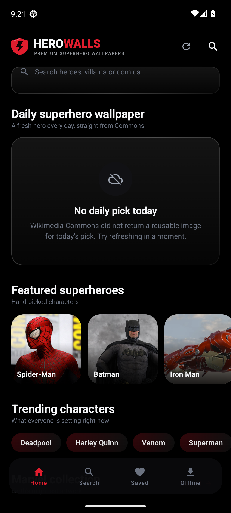
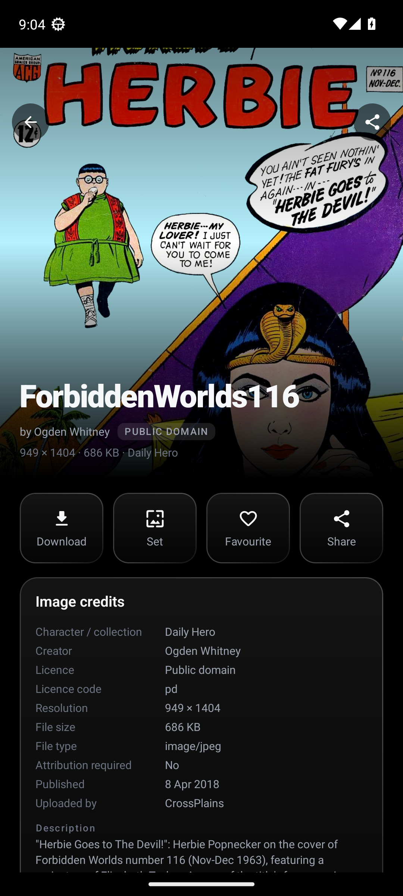

# HeroWalls

**Premium superhero wallpapers for Android.** Every wallpaper is fetched live from
[Wikimedia Commons](https://commons.wikimedia.org/) through its public API, filtered by a licence
gate that only allows artwork you can legally reuse, and shown with full attribution.

[**Download the APK**](https://github.com/technicalnihilist-lgtm/HeroWalls/releases/latest) ·
Android 7.0+ · no account, no ads, no bundled artwork





---

## What it does

* **Live, not bundled.** Categories are Wikimedia Commons searches, so newly uploaded artwork
  appears on its own. The "Latest wallpapers" rail re-queries Commons newest-first every 45 seconds
  and marks new arrivals with a NEW badge.
* **46 categories** — 14 Marvel, 10 DC, 10 villains and 8 collections (superhero groups, comic book
  art, logos, classic heroes, animated heroes, superhero movies, villain wallpapers, cinematic art).
* **Real wallpaper actions** — download the original file, set it as home screen, lock screen or
  both through Android's `WallpaperManager`, favourite it, or share it with its credits attached.
* **Offline library** — favourites, downloads and recently viewed are stored in Room and survive
  restarts; a WorkManager job keeps favourites available offline.
* **Full credits** — creator, licence, licence link, source page, resolution, file size, upload date
  and a modification statement on every image, plus a credits screen and licence policy in-app.

## Licensing

Only files whose machine-readable Commons licence permits commercial use and derivative works are
shown: **Public Domain, CC0, CC BY, CC BY-SA**. Fair use, non-free, CC BY-NC, CC BY-ND and
unverifiable files are rejected before they reach the UI, using exact licence-code matching
(`cc-by-nc-4.0` can never be mistaken for `cc-by-4.0`). Movie posters and press artwork are only
shown when they carry an accepted licence.

Search results are additionally scored so a place name or an unrelated object (a railway station
called Batman, a car in a "superhero comic" search) cannot pass as character artwork. When nothing
qualifies, the app shows an empty shelf rather than unlicensed images.

**Only superhero artwork.** Commons full-text search is loose: *Black Widow* also returns the P-61
night fighter, *Ultron* returns a Voigtländer camera lens and *Wolverine* returns the animal. Every
candidate is checked against a character/franchise lexicon before it can appear, and real-world
objects, animals and place names (station, aircraft, lens, zoo, dinosaur) are penalised out of the
results. The daily hero card additionally requires a **named** character, so a generic comedy comic
that merely mentions "superhero" in its description never becomes the wallpaper of the day.

Marvel, DC, Spider-Man, Batman and all related characters and logos are trademarks of their
respective owners. HeroWalls is an unofficial browser of freely licensed artwork and is not
affiliated with any publisher or studio. See [docs/CREDITS.md](docs/CREDITS.md).

## Build

```bash
./gradlew :app:assembleDebug        # debug APK  -> app/build/outputs/apk/debug/
./gradlew :app:testDebugUnitTest    # licence-gate unit tests
```

Kotlin 1.9.24 · Jetpack Compose (BOM 2024.06) · Material 3 · Retrofit + OkHttp · Coil · Room (KSP)
· WorkManager · minSdk 24 · targetSdk 34 · AGP 8.5.2 · Gradle 8.7.

## CI

| Workflow | Purpose |
|---|---|
| `Build APK` | runs the licence tests, builds the APK and attaches it to the `v1.0.0` release |
| `Screenshots` | boots an Android 33 emulator, installs the APK, walks the app and commits screenshots to `docs/screenshots/` |

Screenshots are captured from a real emulator run of the built APK, never mocked up.
